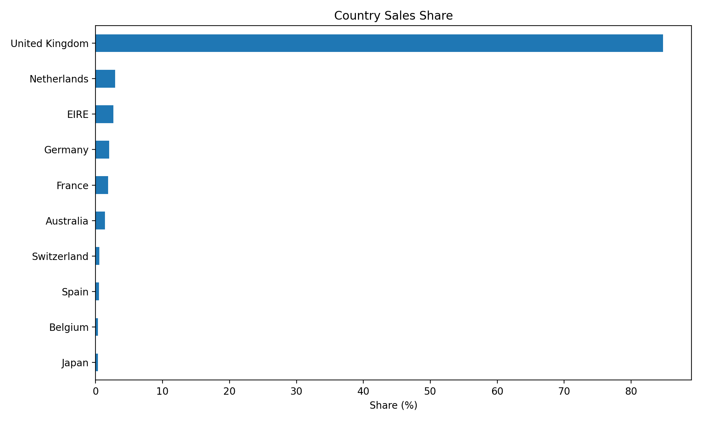
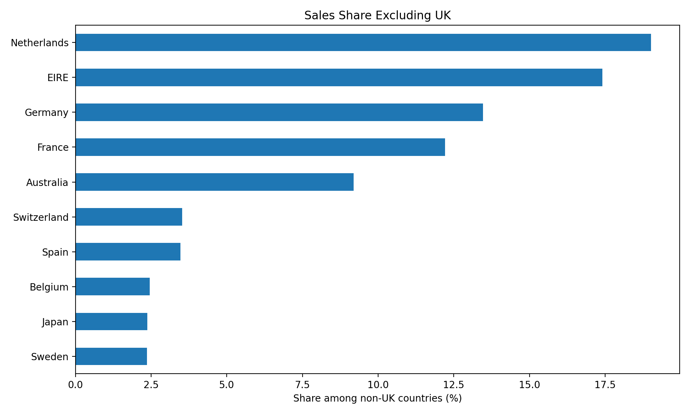
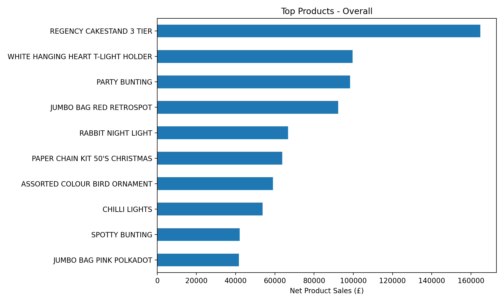
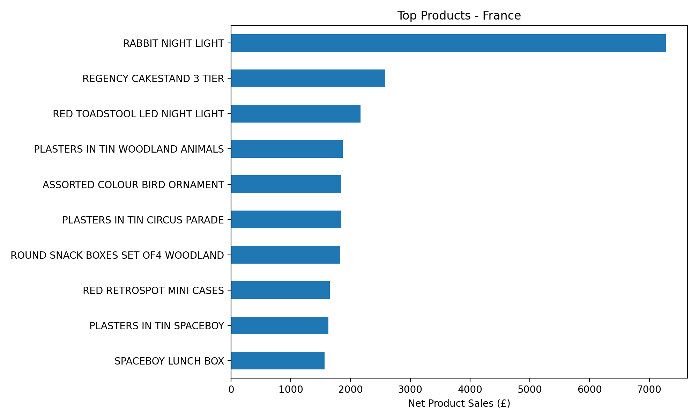

# Online Retail Sales Analysis

I took a year of transactions from a UK online retailer and tried to answer three questions:

1. Where do the sales come from? Which countries, and which products?
2. How much do cancellations take away?
3. How does one country compare with the business as a whole?

It's one Python script (pandas and matplotlib), and this page walks through what I did and what I found.

## The data

The data is the Online Retail dataset from the UCI Machine Learning Repository. It has 541,909 invoice lines from 38 countries, running from 1 December 2010 to 9 December 2011. Amounts are in pounds (£). The last month is incomplete because the data stops on the 9th.

## Cleaning: figuring out what each row is

The first thing I noticed is that not every row is a normal sale. Some are cancellations, some are postage or bank fees, and two are bad debt write-offs. So before calculating anything, I gave every row a type.

| Type | Rows | Amount | What it is |
|---|---|---|---|
| Product sale | 527,795 | £10,272,184 | Positive quantity and price |
| Cancellation | 8,765 | -£481,837 | Invoice number starts with "C" |
| Non-product | 2,832 | -£20,476 | Postage, manual entries, bank charges, Amazon fees, discounts and similar codes |
| Zero-price | 2,515 | £0 | Rows with a price of 0 |
| Bad debt | 2 | -£22,124 | Two "Adjust bad debt" rows with a negative price |
| **Total** | 541,909 | **£9,747,748** | |

These add up exactly to the total of every transaction. The script checks this and stops with an error if the numbers ever stop matching.

Two choices I made along the way:

- **Postage and fees get their own group.** When I left them in, "DOTCOM POSTAGE" showed up as the best-selling product.
- **I kept the duplicate rows.** There are 5,268 extra copies, worth about 0.2% of sales, so removing them wouldn't change the picture. If you'd rather drop them, there's a `REMOVE_DUPLICATES` switch at the top of the script.

## What I found

**The UK is most of the business.** It makes up about 85% of net product sales. Of the other countries, the biggest are the Netherlands (19% of the non-UK total), Ireland (17%), Germany (14%), France (12%) and Australia (9%).




**Cancellations cost about 4.7% of product sales.** Customers placed £10.27M of product orders and cancelled £0.48M of them.

**The best sellers** are the Regency Cakestand 3 Tier (about £165k), the White Hanging Heart T-Light Holder (about £100k) and the Party Bunting (about £98k).



**Why I rank products by net sales.** My first version ranked products before taking cancellations off, and "Paper Craft, Little Birdie" came out second with £168k. That looked odd, so I looked at the actual rows. It was a single order of 80,995 units, and the same customer cancelled it 12 minutes later, so its net sales are zero. The Medium Ceramic Top Storage Jar had a similar £77k order that was cancelled after 16 minutes. Ranking by net sales takes care of this.

**France compared with the whole business:**

| | Overall | France |
|---|---|---|
| Product sales | £10,272,184 | £184,583 |
| Cancellations | £481,837 | £2,419 |
| Cancellations as % of product sales | 4.69% | 1.31% |
| Share of overall product sales | 100% | 1.80% |

France is a small market, only 1.8% of product sales, and its customers cancel far less than average. Its top product is the Rabbit Night Light (about £7.3k), which sells nearly three times as much as the second one. That product is only 5th overall, so French customers buy a bit differently from the rest.



## Files

| File | What it does |
|---|---|
| `retail_analysis.py` | Loads the data, labels the transactions, calculates the numbers and saves the charts |
| `Online_Retail_Practice.xlsx` | The data |
| `figures/` | The charts the script produces |
| `requirements.txt` | Python packages needed |

## How to run it

1. Install the packages:
   ```
   pip install -r requirements.txt
   ```
2. Keep `Online_Retail_Practice.xlsx` in the same folder as the script.
3. Run the script and type a country when it asks (for example `France`):
   ```
   python retail_analysis.py
   ```

It prints the comparison table and saves four charts in `figures/`. Three of them are the same every time. The fourth is the product chart for the country you picked, saved as `products_<country>.png`.

## Limitations

- **Cancellations aren't matched to the original sale.** I can see that an invoice was cancelled, but not which earlier invoice it refers to. Some may belong to sales from before the data starts. That's why I call it "cancellations" and not a "return rate".
- **Some of the labelling is by hand.** I picked the list of non-product codes by going through the data, so I may have missed a special code. A few gift vouchers and sample items are still counted as product sales.
- **About 25% of rows have no customer ID,** and those rows make up about 16% of product sales. Because of that, I didn't try any customer analysis.
- **December 2011 is only 9 days long,** so I left out monthly trends.
- **This describes what happened, not why.** I haven't tried to explain the differences between countries or products.

## What I learned

- Real transaction data is messy, and a big part of the work was figuring out what each row actually is before I could trust any number.
- Checking that everything adds up to the total caught a mistake in my first attempt. I had counted platform fees as cancellations, which made the cancellation rate almost twice as high as it should be.
- A ranking can look reasonable and still be wrong. I only found the cancelled orders by checking the biggest items by hand.

## Tools

Python, pandas, matplotlib