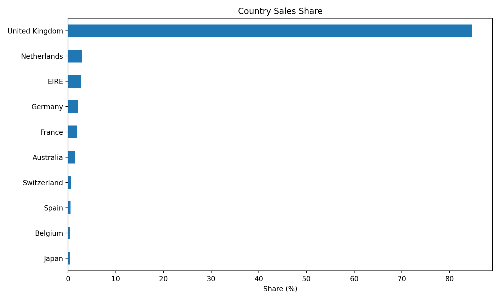
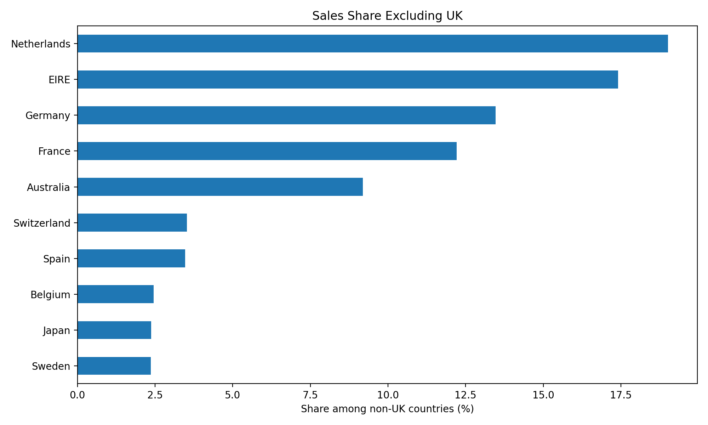
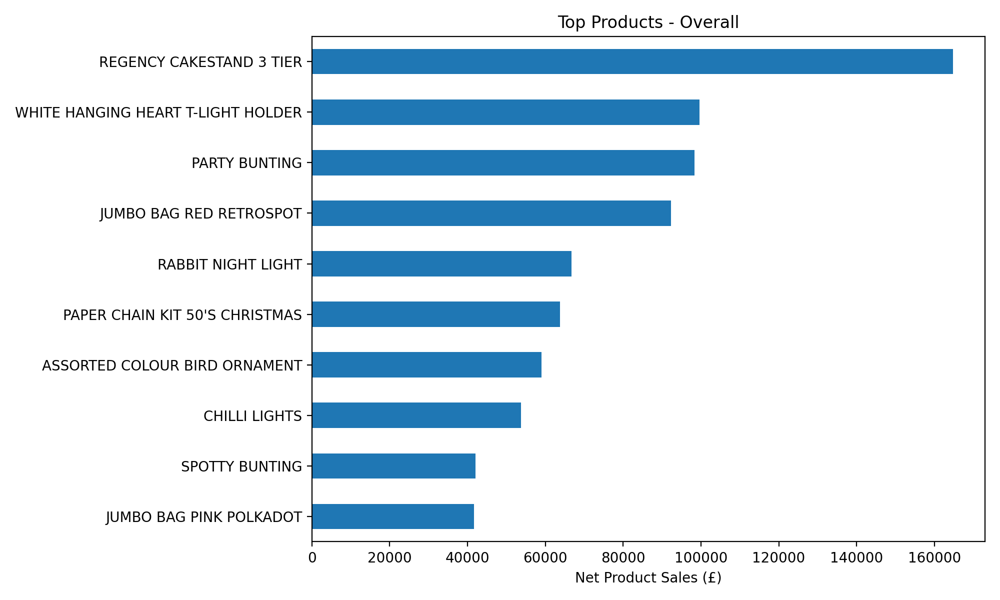
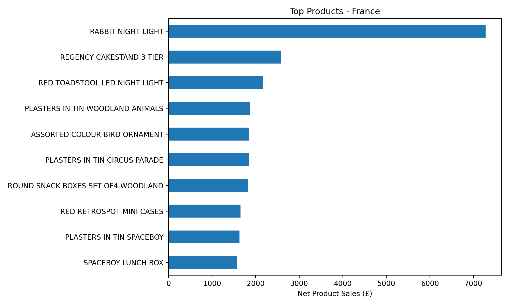
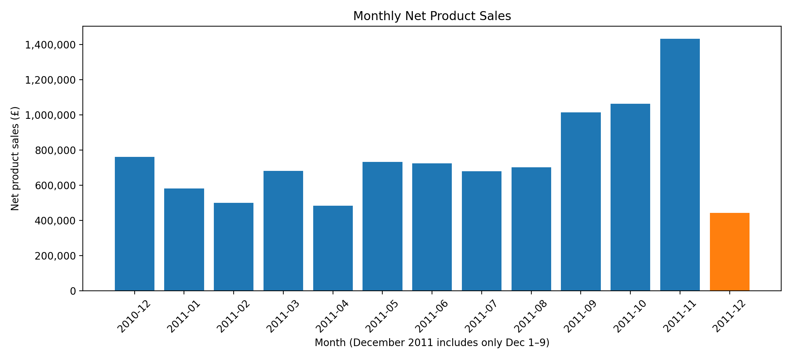
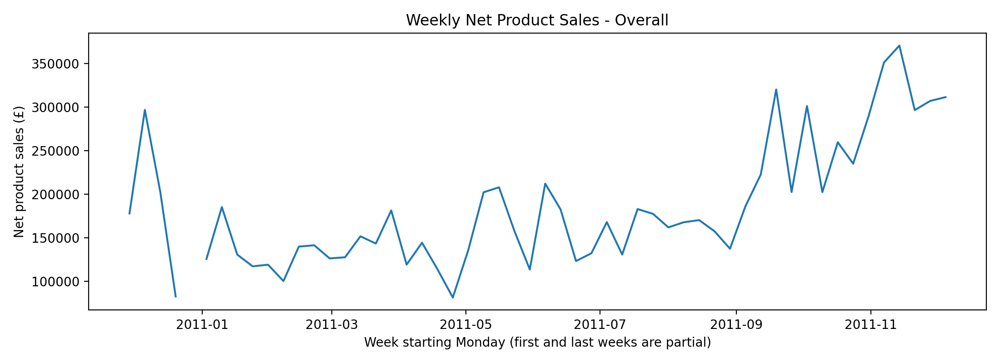
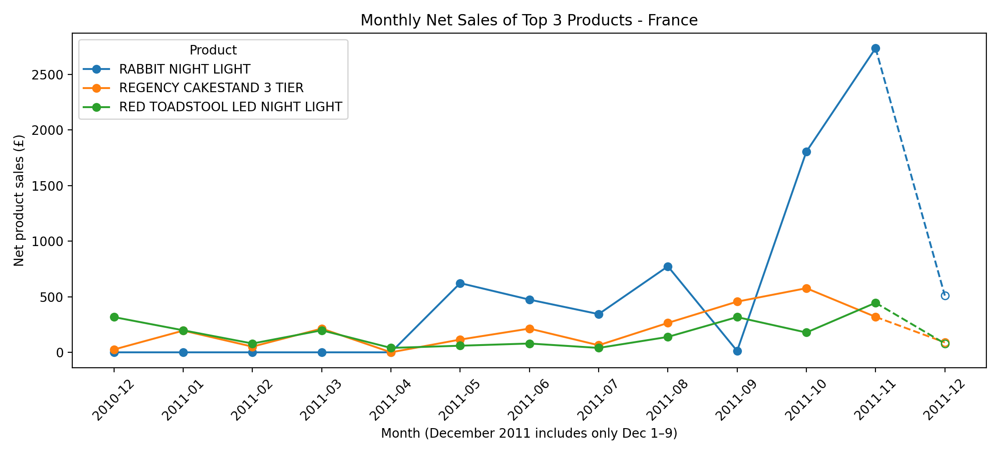
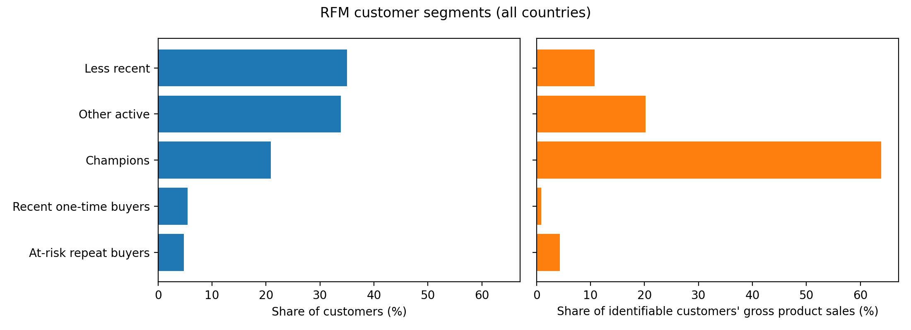

# Online Retail Sales Analysis

I used a year of transactions from a UK online retailer to see which countries and products drove sales, how much cancellations took away, and how individual markets compared with the business overall. I also looked at monthly and weekly sales and grouped customers by their purchase history.

## The data

The data is the Online Retail dataset from the UCI Machine Learning Repository. It has 541,909 invoice lines from 38 countries, running from 1 December 2010 to 9 December 2011. Amounts are in pounds (£). The last month is incomplete because the data stops on the 9th.

## Cleaning the transactions

I classified each invoice line before calculating sales. This kept postage, fees, cancellations and bad debt separate from product sales.

| Type | Rows | Amount | What it is |
|---|---|---|---|
| Product sale | 527,795 | £10,272,184 | Positive quantity and price |
| Cancellation | 8,765 | -£481,837 | Invoice number starts with "C" |
| Non-product | 2,832 | -£20,476 | Postage, manual entries, bank charges, Amazon fees, discounts and similar codes |
| Zero-price | 2,515 | £0 | Rows with a price of 0 |
| Bad debt | 2 | -£22,124 | Two "Adjust bad debt" rows with a negative price |
| **Total** | 541,909 | **£9,747,748** | |

The script checks that the amounts reconcile to the transaction total. I started separating postage and fees after "DOTCOM POSTAGE" turned up as my best-selling product. I kept the 5,268 duplicate copies because they account for about 0.2% of sales. The `REMOVE_DUPLICATES` switch lets you exclude them.

## What I found

The UK accounts for about 85% of net product sales. Of the other countries, the biggest are the Netherlands (19% of the non-UK total), Ireland (17%), Germany (14%), France (12%) and Australia (9%).




Cancellations accounted for £0.48M of £10.27M in product sales (4.7%).

The best sellers by net sales are the Regency Cakestand 3 Tier (about £165k), the White Hanging Heart T-Light Holder (about £100k) and the Party Bunting (about £98k).



When I first ranked products by gross sales, "Paper Craft, Little Birdie" came out second with £168k. That looked odd, so I looked at the actual rows. It was a single order of 80,995 units, and the same customer cancelled it 12 minutes later, so its net sales are zero. The Medium Ceramic Top Storage Jar had a similar £77k order that was cancelled after 16 minutes. I now subtract cancellations before ranking products.

### France and overall sales

| | Overall | France |
|---|---|---|
| Product sales | £10,272,184 | £184,583 |
| Cancellations | £481,837 | £2,419 |
| Cancellations as % of product sales | 4.69% | 1.31% |
| Share of overall product sales | 100% | 1.80% |

France is a small market, only 1.8% of product sales, and its customers cancel far less than average. Its top product is the Rabbit Night Light (about £7.3k), which sells nearly three times as much as the second one. It ranked fifth overall.



## How sales change over time

Net product sales were mostly between £480k and £760k a month until August. Then they climbed to about £1.01M in September, £1.06M in October and £1.43M in November, the highest month in the data. That fits a pre-Christmas rush for a gift and homeware retailer, but with only one year of data I can't tell seasonality apart from real growth.




December 2011 (orange) covers only the first nine days. The weekly chart leaves a gap where the dataset has no records from 24 December 2010 to 3 January 2011. Both the monthly and weekly totals reconcile to overall net product sales.

In France, the Rabbit Night Light earned about 62% of its net sales in October and November.



## Customer segments (RFM)

I grouped customers by how recently they bought (Recency), how often (Frequency) and how much they spent (Monetary). The 4,334 customers in this analysis account for 85.3% of product sales. I call a customer "eligible" if they have a customer ID and at least one product purchase. Cancellations aren't subtracted, so Monetary is gross product spend. The reference date is 10 December 2011, the day after the data ends.

| Segment | Customers | Share of customers | Share of sales |
|---|---|---|---|
| Less recent | 1,517 | 35.0% | 10.8% |
| Other active | 1,467 | 33.9% | 20.2% |
| Champions | 905 | 20.9% | 63.9% |
| Recent one-time buyers | 238 | 5.5% | 0.9% |
| At-risk repeat buyers | 207 | 4.8% | 4.3% |

Champions score high on all three measures. They make up about a fifth of customers and account for nearly two-thirds of the gross product spend among customers with IDs. A typical Champion ordered 8 times, spent about £2,700 and last bought around 10 days before the reference date and data ends.

A typical at-risk repeat buyer ordered five times and spent about £1,400. Their last purchases were at least 73 days before the reference date, with a typical gap of 108 days.

Customers are scored 1 to 5 by percentile rank. Many customers have the same number of orders, so the Frequency score has no 2, and "Other active" covers everyone outside the other four groups, including one-time buyers with a Recency score of 3.



France had 87 eligible customers. Champions made up 29% of that group (21% overall) and accounted for 65% of its gross product spend.

## Files

| File | What it does |
|---|---|
| `retail_analysis.py` | Loads the data, labels the transactions, calculates the numbers and saves the charts |
| `sales_trends.py` | Monthly and weekly sales trends and the top-products chart, called from `retail_analysis.py` |
| `customer_segmentation.py` | RFM scores and customer segments, called from `retail_analysis.py` |
| `country_comparison.py` | Compares the selected country's customer segments with all customers |
| `Online_Retail_Practice.xlsx` | The data |
| `figures/` | The charts the script produces |
| `requirements.txt` | Python packages needed |

## How to run it

1. Install the Python packages.
   ```
   pip install -r requirements.txt
   ```
2. Keep `Online_Retail_Practice.xlsx` in the same folder as the script.
3. Run the script and enter a country such as `France` when prompted.
   ```
   python retail_analysis.py
   ```

For a country with product sales, the script normally prints sales and customer comparisons and saves up to ten charts in `figures/`. Six are shared across runs. Four depend on the country, including `products_france.png` and `monthly_top_products_france.png`.

## Limitations

- The dataset gives me cancellation invoices without a reliable link to the original sale. Some cancellations may relate to sales before the observation period, so I report the cancelled amount as a share of product sales.
- I classified special stock codes by hand. Some gift vouchers and samples still count as product sales.
- About a quarter of invoice lines lack a customer ID. The customer analysis covers the 85.3% of product sales with an ID, before cancellations.
- The dataset covers one year, which gives me too little history to separate seasonality from growth or establish what caused the differences across markets.
- The country comparison warns when a country has fewer than 30 eligible customers. Even above that threshold, individual segments can be small. In France, 2.30% in the at-risk repeat buyer segment represents two people. I haven't tested whether the at-risk label predicts future purchases.
- Overall includes the selected country. The UK accounts for about 90% of eligible customers, so its customer mix heavily influences the benchmark. France makes up a smaller share and has less influence on the comparison.
- Eight customers bought in more than one country. Each keeps the same global RFM segment and counts once overall and once per country where they bought. Only purchases made in that country contribute to its spending totals.

## What I learned

- Checking that everything adds up to the total caught a mistake in my first attempt. I had counted platform fees as cancellations, which made the cancellation rate almost twice as high as it should be.
- Checking the largest individual orders by hand helped me find the cancellations that distorted the product ranking.

## Tools

Python, pandas, matplotlib
